<div align="center">

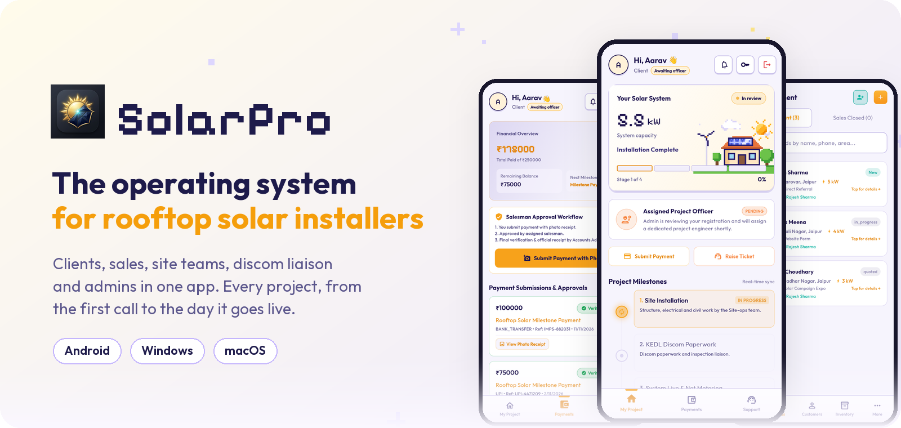

<br/><br/>

[](https://github.com/rightads/Solar-Mobile-App/releases/tag/Android)
[](https://github.com/rightads/Solar-Mobile-App/releases/tag/Windows)
[](https://solarpro-app.in)

<br/>


<sub>
<a href="#-why-solarpro">Why SolarPro</a> ·
<a href="#-screenshots">Screenshots</a> ·
<a href="#-features">Features</a> ·
<a href="#-the-10-stage-journey">Workflow</a> ·
<a href="#%EF%B8%8F-architecture">Architecture</a> ·
<a href="#-quick-start">Quick start</a> ·
<a href="#-deployment">Deployment</a> ·
<a href="#-api-reference">API</a>
</sub>

</div>

<br/>

## 🎬 See it in action

<div align="center">

<a href="https://youtu.be/MwXk973bB_o">
  
</a>

<br/><br/>

[](https://youtu.be/MwXk973bB_o)

<sub>41 seconds, with sound</sub>

</div>

<br/>

## ☀️ Why SolarPro

Most solar installers still run projects on WhatsApp groups, paper forms and spreadsheets. Files for the electricity board get lost, payment proofs go missing, site teams don't know what's next, and clients keep calling to ask where their project is.

SolarPro replaces all of that with one shared workflow:

<table>
<tr>
<td width="33%" valign="top">

### 🏠 Clients
Follow their installation through 10 clear stages, upload payment proof, see documents and raise service tickets, without having to call anyone.

</td>
<td width="33%" valign="top">

### 👷 Field staff
Each role gets its own work queue. When one team finishes, the project moves to the next team automatically.

</td>
<td width="33%" valign="top">

### 🛡️ Admins
Approve new staff, verify payments, assign work and see every project's status in one place.

</td>
</tr>
</table>

<br/>

## 📱 Screenshots

<div align="center">

<table>
<tr>
<td align="center" width="25%">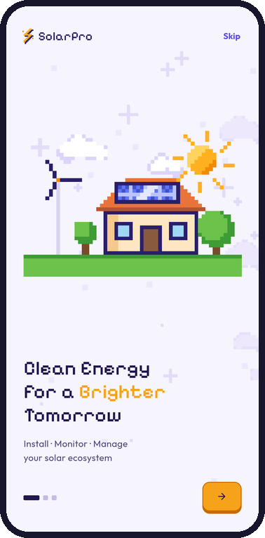<br/><sub><b>Welcome</b></sub></td>
<td align="center" width="25%">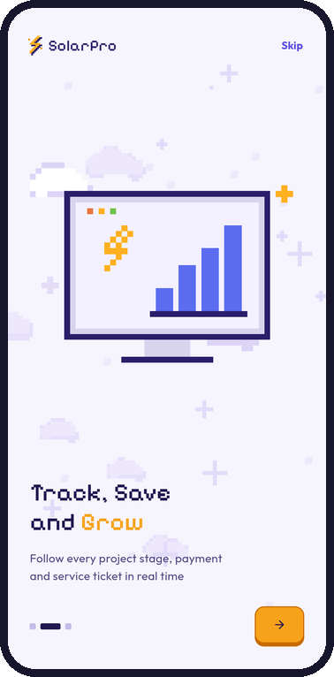<br/><sub><b>Onboarding</b></sub></td>
<td align="center" width="25%">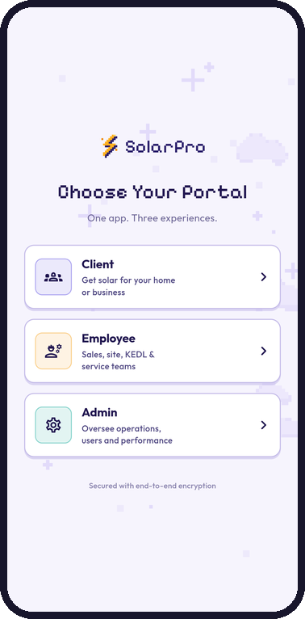<br/><sub><b>Pick a portal</b><br/>Client · Employee · Admin</sub></td>
<td align="center" width="25%">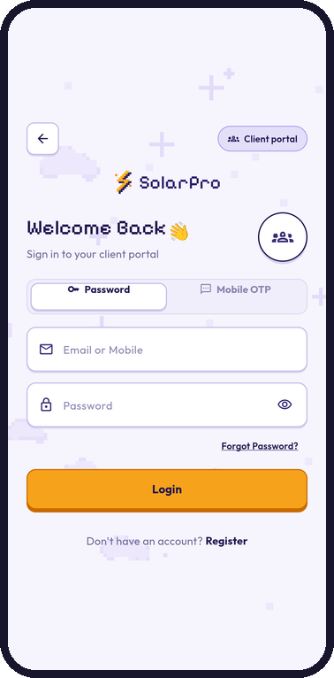<br/><sub><b>Sign in</b><br/>Password or SMS code</sub></td>
</tr>
<tr>
<td align="center">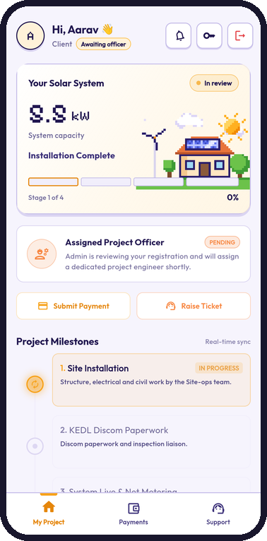<br/><sub><b>Client · My project</b><br/>System, officer, milestones</sub></td>
<td align="center">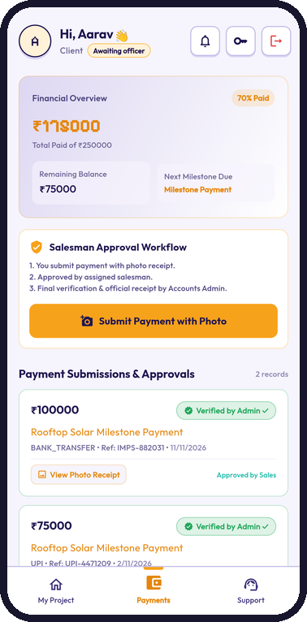<br/><sub><b>Client · Payments</b><br/>Proof upload & approvals</sub></td>
<td align="center">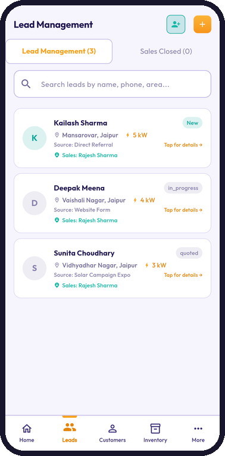<br/><sub><b>Admin · Leads</b><br/>Pipeline by salesperson</sub></td>
<td align="center">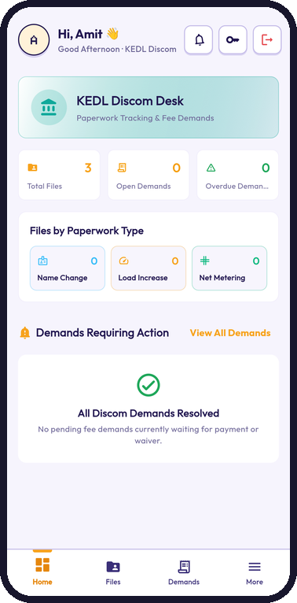<br/><sub><b>KEDL · Discom desk</b><br/>Files & fee demands</sub></td>
</tr>
</table>

<sub>Screenshots use made-up demo data.</sub>

</div>

<br/>

## ✨ Features

<table>
<tr>
<td width="50%" valign="top">

#### 🏠 Client portal
- 10-stage progress tracker for the installation
- Payment history and proof upload (UPI, IMPS, cheque)
- Project documents and demand notes from the electricity board
- Service tickets with comments and reopen
- Assigned project officer card

</td>
<td width="50%" valign="top">

#### 💼 Sales
- Lead pipeline: create, assign, convert, mark lost
- KYC checklist: Aadhaar, electricity bill, property papers, cancelled cheque, photo
- First approval of client payments before admin verification

</td>
</tr>
<tr>
<td valign="top">

#### 🔧 Site operations
- Structure, electrical and civil work assignments
- Start, complete and reopen tasks
- Site photo uploads and a work calendar

</td>
<td valign="top">

#### ⚡ Electricity board (KEDL) liaison
- Name change, load enhancement and net-meter files
- Demand notes and status updates for each file
- Dedicated KEDL dashboard

</td>
</tr>
<tr>
<td valign="top">

#### 🛠️ Service & maintenance
- Ticket queue with technician assignment
- Status updates and comment threads
- Handover after the system goes live

</td>
<td valign="top">

#### 🛡️ Super admin
- New staff accounts wait for admin approval
- Teams, employees and task assignment
- Final payment verification and rejection
- In-app notifications and unread counts

</td>
</tr>
</table>

<br/>

## 🔄 The 10-stage journey

Every project moves through the same stages, and each handoff goes to the team responsible for the next step.

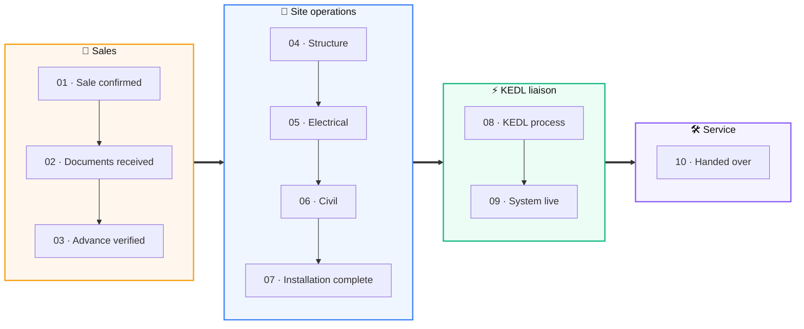

<details>
<summary><b>Stage details</b></summary>
<br/>

| # | Stage key | What happens | Owner |
|:-:|:--|:--|:--|
| 01 | `SALE_CONFIRMED` | Deal closed with the client | Sales |
| 02 | `DOCUMENTS_RECEIVED` | All 5 KYC documents uploaded and checked | Sales |
| 03 | `ADVANCE_VERIFIED` | Advance payment approved by sales, verified by admin | Sales → Admin |
| 04 | `STRUCTURE_WORK` | Mounting structure built on the roof | Structure team |
| 05 | `ELECTRICAL_WORK` | Panels, inverter and wiring installed | Electrical team |
| 06 | `CIVIL_WORK` | Foundations and earthing finished | Civil team |
| 07 | `INSTALLATION_COMPLETE` | Installation finished and tested | Site operations |
| 08 | `KEDL_PROCESS` | Name change, load enhancement and net-meter files | KEDL liaison |
| 09 | `SYSTEM_LIVE` | Net meter installed, system connected to the grid | KEDL liaison |
| 10 | `HANDED_OVER` | Warranty documents handed to the client | Service |

</details>

<br/>

## 🏗️ Architecture

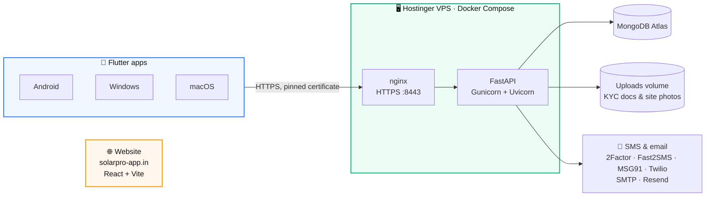

<details>
<summary><b>Tech stack</b></summary>
<br/>

| Layer | Built with |
|:--|:--|
| **App** | Flutter 3.44, Dart 3, Riverpod, GoRouter, fl_chart |
| **API** | FastAPI, Pydantic v2, PyJWT, bcrypt, Gunicorn + Uvicorn |
| **Database** | MongoDB Atlas (PyMongo) |
| **Messaging** | 2Factor.in, Fast2SMS, MSG91, Twilio for SMS; SMTP or Resend for email |
| **Website** | React + Vite, served by LiteSpeed |
| **Infrastructure** | Docker Compose, nginx 1.27, Hostinger VPS, GitHub Actions |

</details>

<br/>

## 🚀 Quick start

> **You need:** Flutter 3.44+, Python 3.12, and optionally Docker.

**1 · Run the backend**

```bash
git clone https://github.com/rightads/Solar-Mobile-App.git
cd Solar-Mobile-App/Backend

cp .env.example .env          # set MONGODB_URI, JWT_SECRET and the other values

python -m venv venv
source venv/bin/activate      # Windows: .\venv\Scripts\Activate.ps1
pip install -r requirements.txt

uvicorn app.main:create_application --factory --host 0.0.0.0 --port 8000 --reload
```

The interactive API docs are at **http://localhost:8000/docs**.

**2 · Run the app**

```bash
cd Solar-Mobile-App/SolarPro
flutter pub get

flutter run                                                     # uses the live API
flutter run --dart-define=API_BASE_URL=http://10.0.2.2:8000/api/v1   # uses your local backend (Android emulator)
```

<details>
<summary><b>Main environment variables</b> (<code>Backend/.env</code>)</summary>
<br/>

| Variable | Purpose |
|:--|:--|
| `ENV` | `dev` or `production` |
| `MONGODB_URI` | MongoDB connection string |
| `JWT_SECRET` | Key used to sign login tokens (at least 32 characters) |
| `TWO_FACTOR_API_KEY` · `FAST2SMS_API_KEY` · `MSG91_AUTH_KEY` · `TWILIO_*` | SMS gateways for OTP codes |
| `SMTP_HOST` · `SMTP_USER` · `SMTP_PASSWORD` · `RESEND_API_KEY` | Email delivery |
| `SUPER_ADMIN_EMAIL` · `SUPER_ADMIN_PHONE` · `SUPER_ADMIN_PASSWORD` | First admin account |
| `STORAGE_PROVIDER` · `STORAGE_*` | File storage settings |

See [`Backend/.env.example`](Backend/.env.example) for the full list.

</details>

<br/>

## 🌐 Deployment

Every push to `main` deploys automatically. Nothing is deployed by hand.

| Workflow | Runs when | What it does |
|:--|:--|:--|
| `backend-ci-cd.yml` | `Backend/**` or `website/**` changes | Lint, security tests and `pip-audit`, then deploys the API and website to the VPS |
| `build_android.yml` | `SolarPro/**` changes | Builds the signed APK and publishes it to the [`Android`](https://github.com/rightads/Solar-Mobile-App/releases/tag/Android) release |
| `build_windows.yml` | `SolarPro/**` changes | Builds the Windows app and publishes it to the [`Windows`](https://github.com/rightads/Solar-Mobile-App/releases/tag/Windows) release |
| `build_macos.yml` | `SolarPro/**` changes | Builds the macOS app as a workflow artifact |

| Service | Address |
|:--|:--|
| Website | [https://solarpro-app.in](https://solarpro-app.in) |
| API | `https://82.29.165.43:8443/api/v1` |
| Health check | `https://82.29.165.43:8443/api/v1/health` |

<details>
<summary><b>How the app connects to the API</b></summary>
<br/>

- The domain `solarpro-app.in` is used only for the website. The apps call the API directly by IP on port **8443**, set in [`app_constants.dart`](SolarPro/lib/core/constants/app_constants.dart) (`serverIp`, `serverPort`).
- The API uses a **self-signed certificate** for `82.29.165.43`, valid until 2036. `Backend/scripts/deploy.sh` creates it on the server in `Backend/certs/`, which is not stored in git.
- The app trusts **only** that certificate. Its SHA-256 fingerprint is pinned in `app_constants.dart` (`apiCertSha256`) and checked by [`pinned_http_overrides.dart`](SolarPro/lib/core/network/pinned_http_overrides.dart):
  ```
  89a63f6cb346b38df113e320a8b88f550ccb586878cfd004e4e7b65e4ef6af4c
  ```
- Browsers and `curl` will warn that the certificate is untrusted. That is expected. To call the API from a terminal:
  ```bash
  openssl s_client -connect 82.29.165.43:8443 </dev/null 2>/dev/null | openssl x509 > api.crt
  curl --cacert api.crt https://82.29.165.43:8443/api/v1/health
  ```

`deploy.sh` starts the `backend`, `nginx` and `website` containers. It saves the API port in `Backend/.env` as `API_HOST_PORT` (the first free port from 8443, reused on later deploys), creates the certificate if it is missing, checks API health over HTTPS, and installs the website build into LiteSpeed.

</details>

> [!WARNING]
> **Never delete `Backend/certs/` on the VPS.** If the certificate is regenerated, every installed app stops connecting until `apiCertSha256` is updated and new builds are shipped. The deploy log prints the new fingerprint as `📌 App settings: API_PORT=… API_CERT_SHA256=…`.

<br/>

## 🔒 Security

- 🔑 **No secrets in the code.** All keys and passwords come from environment variables and GitHub secrets.
- 📌 **Certificate pinning.** The app only talks to the server's own certificate, and release builds refuse any non-HTTPS API address.
- 📲 **Verified sign-ups.** New accounts confirm both email and phone. Sign-in codes are hashed and rate-limited.
- 🧑‍💼 **No self-promotion to staff.** A new staff account stays pending until an admin approves it.
- 🔁 **Rotating sessions.** Refresh tokens are rotated, and users can sign out of every device.
- 🧹 **Input sanitising.** Search inputs are escaped to block database injection.

The full review is in [`SECURITY_AUDIT_REPORT.md`](SECURITY_AUDIT_REPORT.md).

<br/>

## 📡 API reference

All routes are under `/api/v1`. The full interactive reference is at `/docs` on a running backend.

| Area | Main routes |
|:--|:--|
| **Health** | `GET /health` |
| **Auth** | `/auth/register` · `/auth/login` · `/auth/request-otp` · `/auth/verify-otp` · `/auth/refresh` · `/auth/logout-all` · `/auth/forgot-password` · `/auth/change-password` · `/auth/me` |
| **Client** | `/client/home` · `/client/payments` · `/client/documents` · `/client/tickets` |
| **Leads** | `/leads` · `/leads/{id}/assign` · `/leads/{id}/convert` · `/leads/{id}/mark-lost` |
| **Customers** | `/customers` · `/customers/{id}/stage` · `/customers/{id}/documents` · `/customers/{id}/timeline` |
| **Payments** | `/customers/{id}/payments` · `/payments/pending` · `/payments/{id}/sales-approve` · `/payments/{id}/verify` · `/payments/{id}/reject` |
| **Work** | `/work-assignments` · `/work-assignments/calendar` · `/work-assignments/{id}/start` · `/work-assignments/{id}/complete` · `/work-assignments/{id}/photos` |
| **KEDL** | `/kedl/dashboard` · `/kedl-files` · `/kedl-files/{id}/status` · `/kedl-files/{id}/demands` |
| **Tickets** | `/tickets` · `/tickets/{id}/assign` · `/tickets/{id}/status` · `/tickets/{id}/comments` |
| **Users & teams** | `/users` · `/users/approvals/list` · `/teams` · `/teams/employees` |
| **Notifications** | `/notifications` · `/notifications/unread-count` · `/notifications/read-all` |
| **Files** | `POST /files` · `GET /files/{id}` |

<br/>

## 📂 Project structure

```text
Solar-Mobile-App/
├── .github/workflows/     CI/CD: backend deploy, Android, Windows and macOS builds
├── Backend/               FastAPI server
│   ├── app/api/v1/        Route handlers (auth, client, leads, KEDL, payments…)
│   ├── app/core/          Settings, security and logging
│   ├── app/db/            MongoDB connection
│   ├── app/services/      Workflow, SMS, email and storage logic
│   └── scripts/deploy.sh  Production deploy script (run by CI)
├── SolarPro/              Flutter app (Android, Windows, macOS)
│   └── lib/
│       ├── core/          Theme, router, network, storage
│       └── features/      admin · auth · client · employee · kedl · leads · payments · tickets
├── website/               React + Vite site for solarpro-app.in
└── docs/assets/           Screenshots
```

<br/>

## 🗺️ Roadmap

- [x] 10-stage workflow with the 4-role handoff
- [x] Real SMS OTP, email verification and admin approval for staff
- [x] Automatic Android, Windows and macOS builds on every push
- [x] In-app update prompt on Android
- [ ] Live inverter data (Sungrow, Growatt, GoodWe, Solis)
- [ ] Roof analysis from satellite images
- [ ] Hindi and regional language support

<br/>

---

<div align="center">

**Made with ☀️ by**

<a href="https://github.com/jadaunaryansingh"></a>
&nbsp;
<a href="https://github.com/xxKrishna2609xx"></a>

<sub><a href="https://github.com/jadaunaryansingh">Aryan Singh Jadaun</a> · <a href="https://github.com/xxKrishna2609xx">Krishna Goyal</a></sub>

<br/>

<sub>Licensed under the MIT License.</sub>

</div>
